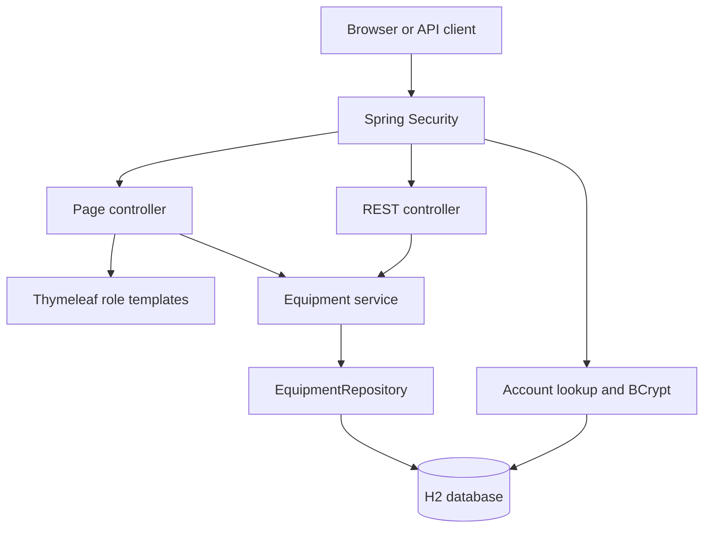

# CATC LabTrack

**Laboratory Equipment Register Web Service · CAT College · Week 1 starter**

A student looking for a multimeter can search by lab location, read its unique asset code and see its current status. The same register serves Computer Engineering, Electrical Engineering, Computer Science, Engineering Technology and Information Technology. Custodians and technicians use the ADMIN page. Instructors and students use the USER page.

## Run the packaged application

With JDK 25 selected, open a terminal beside pom.xml, check `java -version` and run `java -jar CATC-LabTrack.jar`. Once startup completes, visit http://localhost:8080/login. Stop the process with Ctrl+C before launching a second copy in IntelliJ. The JAR contains this snapshot. After editing the sources, run the IntelliJ main class or rebuild with Maven.

## Start in IntelliJ IDEA

1. Extract the ZIP. In IntelliJ, choose **File → Open** and select the **pom.xml** inside **CATC-LabTrack**. Open it as a Maven project.
2. In **File → Project Structure → Project**, choose **JDK 25** as the SDK. Use **Download JDK** if needed. Set language level to **SDK default**. Under **Settings → Build Tools → Maven**, select bundled Maven. Under **Runner** and **Importing**, select JDK 25 where a JDK choice appears.
3. Open the Maven tool window and reload the project. Allow internet access for the first dependency download.
4. Open **src/main/java/ph/edu/catc/labtrack/LabTrackApplication.java**. Run its **main** method using the green arrow. Wait for the console to show **Started LabTrackApplication**.
5. Visit **http://localhost:8080/**. Sign in using the LabTrack login form. The home route takes you to the appropriate workspace.

| Role | Username | Local demo password | Landing page |
|---|---|---|---|
| ADMIN | admin | admin-demo | /admin |
| USER | user | user-demo | /user |

Click Sign out to switch accounts. HTTP Basic is available to API clients. The server binds to the loopback address. H2 runs in memory. Stopping and restarting clears edits and recreates both accounts and two invented samples. Each saved account contains a BCrypt hash.

**Terminal option.** From the extracted folder containing pom.xml, run `mvn -v` and confirm Java 25 and Maven 3.6.3 or later. Run `mvn spring-boot:run`. If Maven cannot find the spring-boot plugin, check that `dir pom.xml` finds this project's POM in your current folder. The IntelliJ main-method instructions work with bundled Maven. Spring Boot serves both pages and their CSS.

## If IntelliJ reports JVM target 5

Extract the updated ZIP into a fresh folder and open its pom.xml as a project. To keep local edits, copy just the updated pom.xml into your existing project and reload Maven.

1. In **File → Project Structure → Project**, select JDK 25 and set the language level to SDK default. Under **Modules → labtrack → Dependencies**, choose **Project SDK**. Under **Sources**, select **Project default** for language level.
2. In **Settings → Build, Execution, Deployment → Compiler → Java Compiler**, set the project bytecode version to **25** and remove any per-module override of **5** for labtrack.
3. In Maven settings, choose **JDK 25** for both the importer and runner. Reload all Maven projects. Run **Maven → Lifecycle → package**. If Java 25 is missing from the language-level choices after adding the SDK, use an IntelliJ IDEA release with Java 25 support.

## Try the first end-to-end feature

Open the USER page and search for **Electrical**. The seeded multimeter appears. Clear the search, open **Register a new item**, and enter **ee-002**, **Clamp meter**, **Electrical Engineering Lab**, **AVAILABLE**. Save, then search again. The new row displays **EE-002**. Repeating the code should display a duplicate warning. With USER credentials, opening **/admin** should produce 403. The ADMIN page has its own template and uses the same table and create form. The course grants creation rights to both roles.

## Architecture design

One Spring Boot Maven module hosts the HTML interface and the JSON API. Both entry points use the same equipment service. A DTO is the data shape accepted or returned at the API boundary. The JPA entity represents the stored row.

**Example request.** A student submits the register form. The form script sends JSON and the session's CSRF token to POST /api/equipment. Spring Security checks the credentials and token. EquipmentController validates EquipmentRequest. Spring injects EquipmentService into the controller through its constructor. The service normalizes the code, checks uniqueness and asks EquipmentRepository to save it. H2 also enforces uniqueness. The controller returns 201, a Location header and an EquipmentResponse. The browser reloads the register.

| Table | Fields and meaning |
|---|---|
| equipment | id (generated key), asset_code (unique item tag), name, location (lab or room), status (AVAILABLE, RESERVED or BORROWED) |
| app_user | username (key), password_hash, role (USER or ADMIN) |

**Borrowing scope.** Status describes an individual asset. For Week 2, changing AVAILABLE to RESERVED or BORROWED will update that existing asset through PUT. Borrower identity, due dates, approval and loan history would need a separate workflow. The starter creates records and displays their current status.

## Five-member ownership

Paths beginning with **J/** below are relative to **src/main/java/ph/edu/catc/labtrack/**. **R/** means **src/main/resources/**. Member numbers are placeholders for your teammates' names.

| Member | Folders and files to manage | Individual deliverable and demo |
|---|---|---|
| 1 · Team leader | Root pom.xml, README.md, docs/, J/setup/, J/LabTrackApplication.java, R/application.properties | Maintain the JDK 25 build and sample setup. Integrate changes, coordinate the ten checks, and demonstrate a clean import and reset. |
| 2 · Equipment data and business rules | J/equipment/model/, J/equipment/repository/, J/equipment/service/ | Own the H2/JPA model, location query and normalized asset code. Implement update and delete service methods. Demonstrate an unchanged code succeeds on update and a conflicting code fails. |
| 3 · REST API and validation | J/api/, J/equipment/dto/ | Implement PUT and DELETE, coordinate their service signatures with Member 2, and add a helpful missing-ID response. Capture 201, 400, 404 and 409 examples. |
| 4 · Security and admin frontend | J/security/, R/schema.sql, R/templates/admin/ | Own database-backed login, CSRF and authorization. Add admin edit/delete controls when the endpoints are ready. Demonstrate ADMIN deletion and USER denial using valid tokens. |
| 5 · User frontend and shared UI | J/web/, R/templates/user/, R/templates/shared/, R/static/ | Own page routing, search, shared HTML/CSS and browser requests. Add user status editing for existing items. Demonstrate finding a breadboard and recording a reservation. |

**Working agreement.** Assign one feature branch per member. Members 2 and 3 agree on method signatures before implementing writes. Members 4 and 5 agree on shared form fields and error messages before changing templates. The leader reviews merges. Each member supplies their own test evidence and explains one request through the layers.

## API contract and milestones

| Operation | Allowed roles | Week 1 starter | Next checkpoint |
|---|---|---|---|
| GET /api/equipment?location=Electrical | USER, ADMIN | 200, case-insensitive partial location filter; omit parameter for all | Retest after edits |
| GET /api/equipment/{id} | USER, ADMIN | 200 or 404 | Add a helpful missing-record message |
| POST /api/equipment | USER, ADMIN | 201, 400 validation, 409 duplicate | Retest both roles |
| GET /api/csrf | USER, ADMIN | Returns token and request header name | Reuse with the same account and session cookie |
| PUT /api/equipment/{id} | USER, ADMIN | Planned | 200, 400, 404 or 409 |
| DELETE /api/equipment/{id} | ADMIN | Security rule configured; handler planned | 204, 404, or 403 for USER with valid token |

**Week 1** — Add names, confirm scope with your instructor, run the first create/read path and explain the diagram.

**Week 2** — Finish update/delete, duplicate-on-update handling, status editing and the remaining error cases.

**Week 3** — Execute the guide's ten checks, save actual responses, finish the editable and PDF write-up, and rehearse individual explanations. Use a fourth week for fixes if available.

**AI-use note.** ChatGPT assisted with this starter, its architecture and the suggested division of work. Each member should record the changes they make and the checks they personally run before submission.

For a repeatable create, fetch and filter demonstration on Windows, open PowerShell in the project root while Spring Boot is running and run `.\docs\try-api.ps1`. It fetches a CSRF token, retains the session cookie and uses a fresh asset code on each run.
